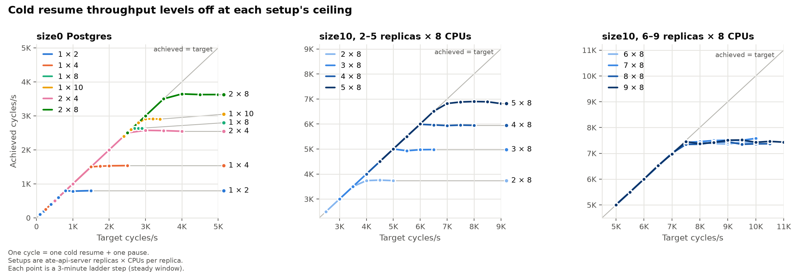
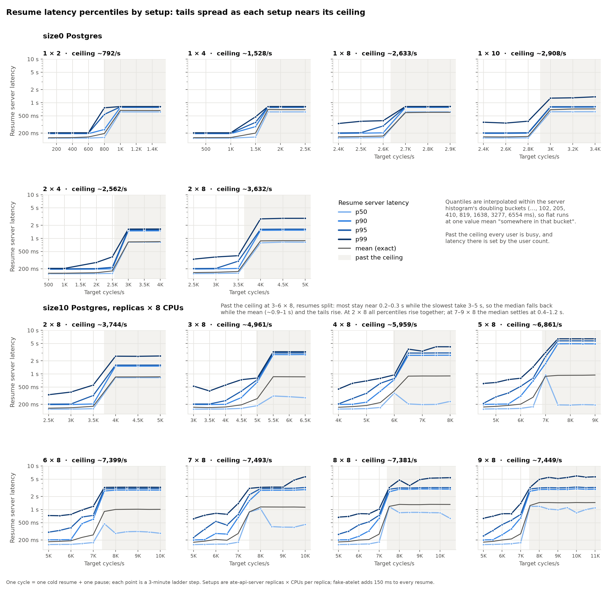
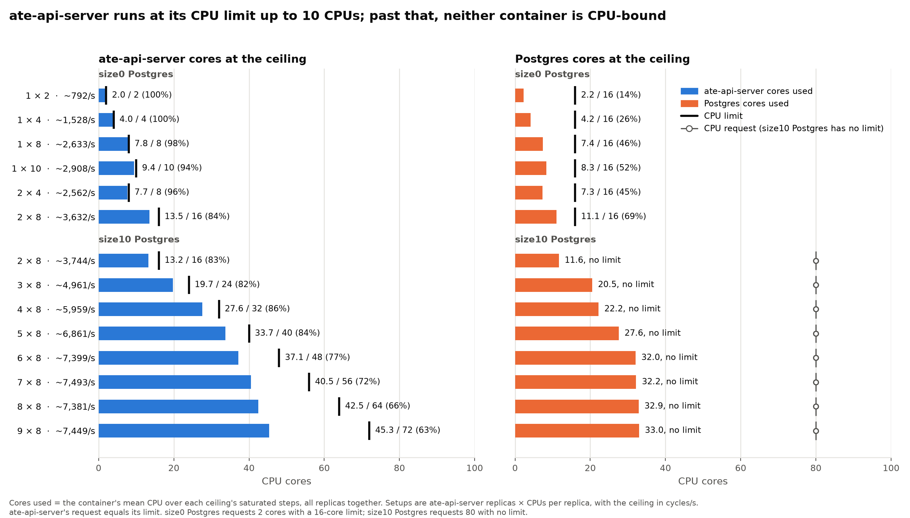
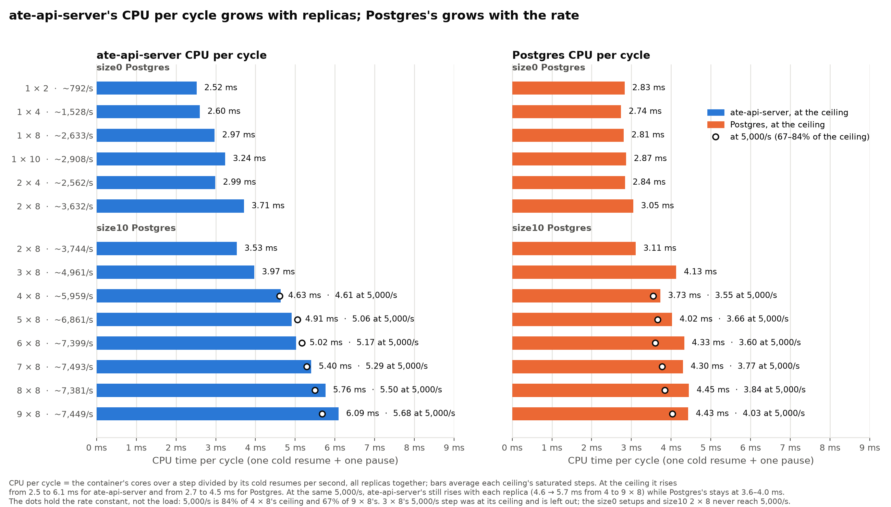
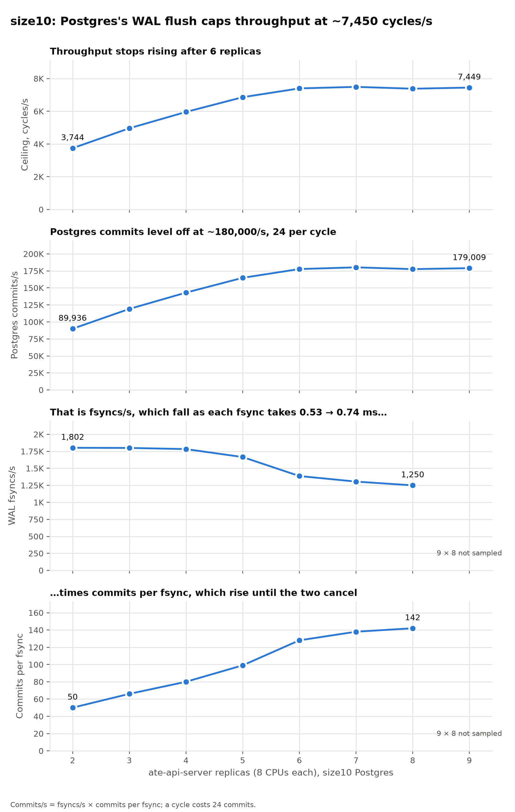
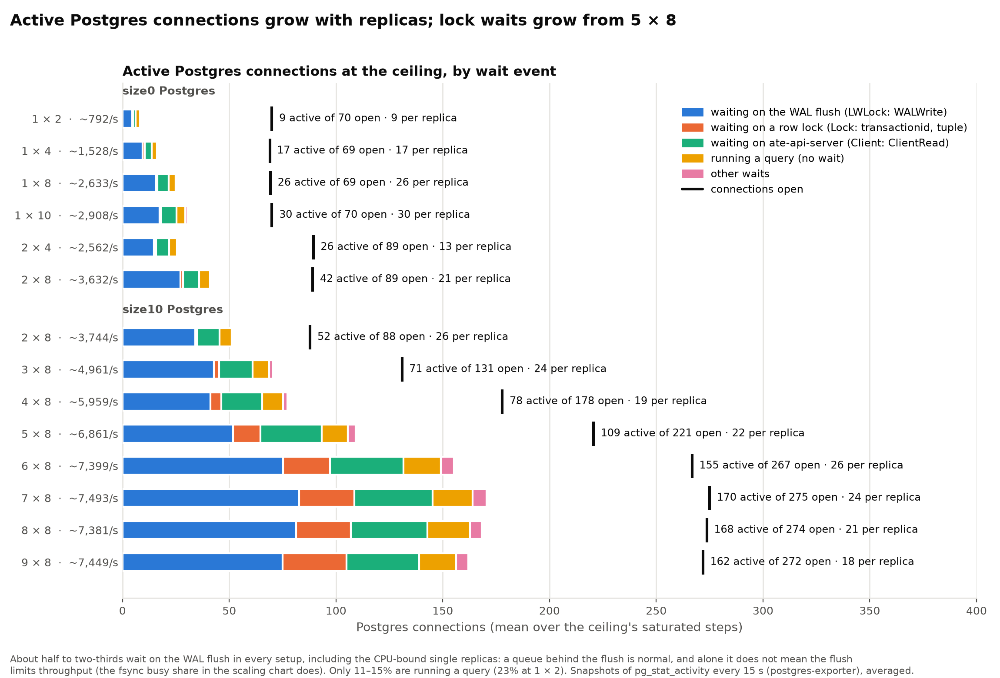
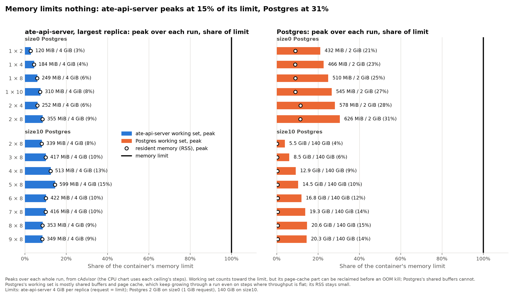

# ate-api-server cold resume capacity

How many cold resume and pause cycles per second ate-api-server and Postgres sustain on the fake data plane, from one 2 CPU replica on size0 Postgres to nine 8 CPU replicas on size10. Every run uses the `resumepaused` workload on code based on upstream main of 2026-10-14.

Throughout, a setup is ate-api-server replicas × CPUs per replica, one cycle is one cold resume plus one pause, and a setup's ceiling is its mean achieved rate over the ladder steps where throughput stopped following the target.

## Result summary

- **[Throughput](#throughput-levels-off-at-each-setups-ceiling):** each setup tracks its target until a ceiling, then goes flat. On size0 the ceiling follows ate-api-server's CPU, about 790, 1530, 2633 and 2908 cycles/s at 2, 4, 8 and 10 CPUs, and splitting CPU across replicas doesn't help; on size10, 8 CPU replicas add throughput up to 6, then stay at about 7400–7500 cycles/s through 9.
- **[Resume latency](#resume-latency-percentiles-by-setup):** below each ceiling a resume takes the 150 ms fake delay plus a few milliseconds. size0's p90–p95 stay in the median's bucket until the ceiling, while p99 rises to about 330–475 ms first; size10's p99 is already 0.45–0.73 s at the lowest steps from 3 × 8 up. Past the ceiling at 3–6 × 8, resumes split into a fast majority and a slow minority taking 3–5 s.
- **[CPU limit and usage](#cpu-limit-and-usage):** ate-api-server runs at its CPU limit up to 10 CPUs; past that its share falls with each replica, to 63% at 9 × 8. Postgres never reaches a CPU limit.
- **[CPU per cycle](#cpu-per-cycle):** ate-api-server's CPU per cycle grows from 2.5 to 6.1 ms and keeps rising with each replica at a fixed 5,000/s; Postgres's grows from 2.7 to 4.5 ms with the rate, not the replica count.
- **[size10 scaling](#size10-scaling-postgress-wal-flush-sets-the-cap):** Postgres's WAL flush caps size10 at about 7,450 cycles/s and 180,000 commits/s. Past 6 replicas, each fsync carries more commits but takes longer, and the two cancel.
- **[Postgres connections](#postgres-connections-by-wait-event):** active connections grow with replicas, about half to two-thirds of them waiting on the WAL flush, a fifth waiting on ate-api-server, and 11–15% running a query; row-lock waits grow from 5 × 8.
- **[Memory](#memory-limit-and-usage):** memory limits nothing: ate-api-server peaks at 15% of its limit and Postgres at 31%.

## Setup

- Isolate mode (fake data plane): fake-atelet on every atelet node answers each call after 150 ms and mints the actor certificate on each restore; 200 fake Workers with room for 1000 actors each, so placement never binds.
- `resumepaused`: each user owns one actor, creates it and makes it cold in the step that adds the user, then resumes and pauses it every iteration. One cycle is one resume plus one pause.
- Users and ladders, every step 3 minutes:

| Postgres | ate-api-server (replicas × CPUs) | Users and actors | Ladder (target cycles/s) |
|---|---|---|---|
| size0 | 1 × 2 | 1000 | 100, 200, 400, 600, 800, 1000, 1500 |
| size0 | 1 × 4 | 2000 | 250, 500, 1000, 1500, 1750, 2000, 2500 |
| size0 | 1 × 8 | 3000 | 2400–2900 in steps of 100 |
| size0 | 1 × 10 | 4000 | 2400–3400 in steps of 200 |
| size0 | 2 × 4 | 4000 | 500, 1000, 2000, 2500, 3000, 3500, 4000 |
| size0 | 2 × 8 | 6000 | 2500–5000 in steps of 500 |
| size10 | 2 × 8 | 6000 | 2500–5000 in steps of 500 |
| size10 | 3 × 8 | 8000 | 3000–6500 in steps of 500 |
| size10 | 4 × 8 | 10,000 | 4000–8000 in steps of 500 |
| size10 | 5 × 8 | 12,000 | 4500–9000 in steps of 500 |
| size10 | 6 × 8 | 14,000 | 5000–10000 in steps of 500 |
| size10 | 7 × 8 | 16,000 | 5000–10000 in steps of 500 |
| size10 | 8 × 8 | 18,000 | 5000–10500 in steps of 500 |
| size10 | 9 × 8 | 20,000 | 5000–11000 in steps of 500 |

- Placement: Postgres, ate-api-server and the runner each on their own node; every ate-api-server replica on one node; fake-atelet on all three.
- The test definitions are from https://github.com/agent-substrate/substrate/pull/2686

## Resources

Each test installed substrate fresh with `hack/install-ate.sh` at `size0` (the size10 tests at `size10`), then `pre_test` applied the test's `ateapi:` block.

**ate-api-server**: CPU request = limit = the test's CPUs per replica, so the pod is Guaranteed and `GOMAXPROCS` follows the limit; 4Gi per replica. The read/write pool is set through `ATE_API_POSTGRES_POOL_MAX_CONNS` in the `ate-api-server-envvars` ConfigMap, sized so every replica's pool plus its 5 owner and watch connections fits Postgres's `max_connections`:

| | 1 replica | 2 replicas, size0 | 2–6 replicas, size10 | 7 replicas, size10 | 8 replicas, size10 | 9 replicas, size10 |
|---|---|---|---|---|---|---|
| Read/write pool per replica | 64 | 40 | 40 | 35 | 30 | 26 |
| Postgres connections, pools plus owner and watch | 69 | 90 | 90–270 | 280 | 280 | 279 |

**Postgres**

| | size0 | size10 |
|---|---|---|
| CPU request / limit | 2 / 16 | 80 / none |
| Memory request / limit | 1Gi / 2Gi | 140Gi / 140Gi |
| `max_connections` | 100 | 300 |
| `shared_buffers` | 128MB | 35GB |
| WAL | PostgreSQL defaults | `wal_buffers = 64MB`, `max_wal_size = 16GB`, `wal_compression = on` |
| Volume | 500Gi pd-balanced | 500Gi pd-balanced |

`pre_test` adds `shared_preload_libraries=pg_stat_statements` as a command-line flag and a postgres_exporter sidecar, which restarts Postgres once before ate-api-server rolls out.

## Charts

### Throughput levels off at each setup's ceiling

Each setup follows the "achieved = target" line until its ceiling, then goes flat. On size0 the ceiling rises with ate-api-server's CPU: about 790, 1530, 2633 and 2908 cycles/s at 2, 4, 8 and 10 CPUs, then 3630 at 2 × 8, where Postgres's WAL flush takes over. Splitting CPU across replicas doesn't help: 2 × 4 reaches about 2560, against 2633 for one 8 CPU replica. On size10 each 8 CPU replica adds throughput up to 6 replicas (about 3744 at 2 × 8 to 7400 at 6 × 8), and 7, 8 and 9 replicas stay at about 7400–7500.

### Resume latency percentiles by setup

Below each ceiling a resume takes fake-atelet's 150 ms plus a few milliseconds. On size0, every percentile sits in the 102–205 ms histogram bucket at low load, which only the 1 × 2, 1 × 4 and 2 × 4 ladders reach. p99 leaves the bucket first: it's at 330–360 ms already at 69–91% of the ceiling (the lowest steps of 1 × 8, 1 × 10 and 2 × 8) and 375–475 ms just below it, while p90 and p95 mostly stay in the bucket until the ceiling. Past the ceiling all percentiles jump together. On size10 the tails spread well before the ceiling: from 3 × 8 up, p99 is already 0.45–0.73 s at the lowest steps while p50 stays near 160 ms. Past the ceiling every user is busy, so latency there reflects the user count rather than the server. At 3–6 × 8 resumes split: most stay near 0.2–0.3 s while the slowest take 3–5 s, so the median falls back while the mean (about 0.9–1 s) and the tails rise. The quantiles are interpolated within doubling buckets; the mean is exact.

## CPU limit and usage

ate-api-server runs at its CPU limit up to 10 CPUs in total: 94–100% at 1 × 2 to 1 × 10, and 96% at 2 × 4, where one replica is at its own limit. Past that, its share falls with each replica, from 83–86% at 2–5 × 8 to 63% at 9 × 8, so more replicas add idle capacity, not throughput. Postgres never reaches a limit: at most 69% of its 16 cores on size0, and on size10 it levels off at about 32–33 cores from 6 replicas on, far below its 80-core request.

## CPU per cycle

At the ceiling, ate-api-server spends 2.5 ms of CPU per cycle at 2 CPUs and 6.1 ms at 9 × 8, about 2.4 times as much; Postgres goes from 2.7 to 4.5 ms. Because rate and replica count rise together at the ceiling, the dots compare setups at the same 5,000/s, 67–84% of their ceilings. There, ate-api-server's cost still rises with each replica, from 4.6 ms at 4 × 8 to 5.7 ms at 9 × 8, while Postgres's stays at 3.6–4.0 ms. ate-api-server's extra cost comes with replicas; Postgres's comes with the rate.

## size10 scaling: Postgres's WAL flush sets the cap

On size10 the ceiling and Postgres's commits/s rise together until 6 replicas, then level off at about 7,450 cycles/s and 180,000 commits/s, 24 commits per cycle. Commits/s is fsyncs/s times commits per fsync. Fsyncs/s fall from about 1,800 to 1,250 as each fsync takes longer, 0.53 to 0.74 ms, while each fsync carries more commits, 50 to 142, as more replicas keep more commits waiting; the two cancel from 6 replicas on. The fsync panels have no 9 × 8 point, because the WAL sampler, which ran on the workstation, missed it during a suspend.

### Postgres connections by wait event

Active Postgres connections grow with replicas, from 9–30 for single replicas to about 155–170 at 6–9 × 8, while each replica keeps a similar 18–26 in flight. About half to two-thirds wait on the WAL flush in every setup, including the CPU-bound single replicas: a queue behind the flush is normal, so this count alone doesn't show the flush limits throughput; the fsync busy share in the scaling chart does. A fifth wait on ate-api-server for its next message (`ClientRead`), and only 11–15% are running a query (23% at 1 × 2). Row-lock waits stay at 1–3 connections up to 3 × 8 and reach 22–30 at 6–9 × 8. No setup uses more than about two-thirds of its open connections.

## Memory limit and usage

Memory limits nothing. ate-api-server's largest replica peaks at 120–600 MiB of its 4 GiB, at most 15%. Postgres reaches 21–31% of its 2 GiB on size0 and 4–15% of its 140 GiB on size10. Postgres's working set is mostly its shared buffers and page cache, which keep growing through a run, while its resident memory stays under about 0.8 GiB; the page-cache part can be reclaimed before an out-of-memory kill, so the bars overstate the pressure. These are peaks over each whole run, not the ceiling's steps.
